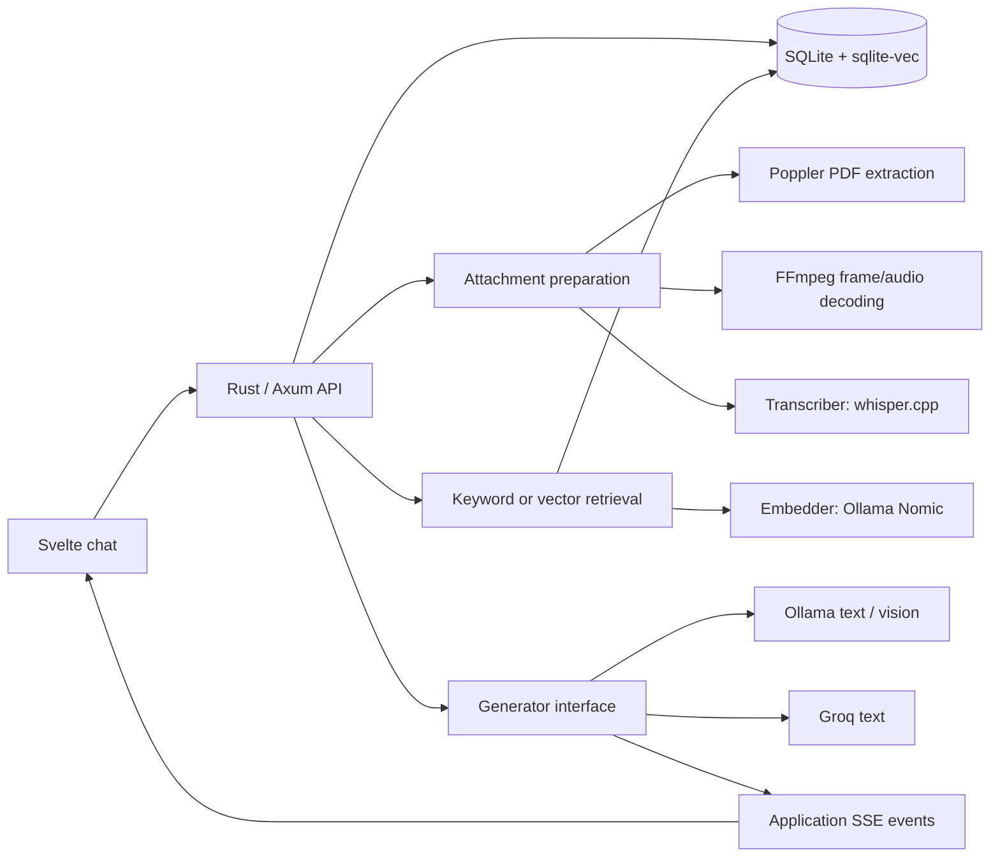

# Architecture: follow one question

The reusable boundary is the application API. The browser speaks the same upload, conversation and streaming protocol regardless of whether text comes from Ollama or Groq.

## Module map

| Module | Responsibility | Question to ask while reading |
| --- | --- | --- |
| `src/main.rs` | Routes, local request boundary, orchestration, budgets and event lifecycle | What happens before the first model token? |
| `src/store.rs` | Corpus import, metadata, vectors and retrieval | What makes repeat import a no-op? |
| `src/providers.rs` | Normalized model contracts and Ollama encoding | Which details belong to an adapter? |
| `src/groq.rs` | Groq authentication, text messages and upstream SSE | How does it reject unsupported image inputs? |
| `src/conversations.rs` | Conversations, blobs, derived assets and partial-run persistence | What survives a browser reload or disconnect? |
| `src/media.rs` | Prepared model context, evidence and processing caches | Which saved data is reused for a follow-up? |
| `src/processors.rs` | PDF extraction and video decoding | What coverage can the model actually receive? |
| `src/speech.rs` | Audio normalization, speech inference and provenance | How is a changed speech model detected? |
| `src/local_process.rs` | Bounded subprocess execution | What happens on timeout or cancellation? |
| `frontend/src/stream.js` | UTF-8 decoding and event validation | Why is EOF insufficient? |
| `frontend/src/components/` | Message, attachment, rich-text and modal views | How can a user inspect intermediate inputs? |

## Request lifecycle

1. The browser uploads attachments separately and receives server-generated IDs. It sends IDs with the question, mode and optional conversation ID.
2. Rust validates the request and acquires the inference permit. Stored conversations receive user/assistant records before generation, so failures can be shown later.
3. Attachment preparation resolves the stored files. Text, PDF pages and transcripts become reference context. Actual validated image bytes, rendered scan pages and sampled frames become labeled image inputs.
4. The server reconstructs bounded history from saved messages. Historical metadata retains the transcript and derived assets originally used. A recent image selects the vision generator for the turn; otherwise the text generator is used.
5. In Research mode, the query is embedded and nearby chunks are retrieved, or the keyword comparator is selected. Attachment evidence is added. Chat mode omits library retrieval.
6. The answering adapter receives normalized instructions, messages and any images. Provider request formats and credentials stay in that adapter.
7. Text deltas stream to the browser and partial output is periodically saved. A valid provider terminal event becomes a final application outcome. Research also checks cited IDs against supplied evidence.

## Stream vocabulary

| Event | Meaning |
| --- | --- |
| `run.started` | The application accepted this run; includes message IDs |
| `input.progress` | Preparation/transcription/generation status |
| `input.ready` | Saved attachment metadata, including extracted content |
| `retrieval.evidence_selected` | The evidence made available to this answer |
| `answer.delta` | Another piece of generated text |
| `run.ended` | Complete, incomplete, refused, failed or interrupted |

The server's concrete adapters currently map non-success finish reasons to incomplete or failed; the protocol also permits refused. The browser labels its own explicit stop as cancelled. Neither a token nor a closed socket proves successful completion. There is no replay cursor, durable worker lease or resumable stream.

## Boundaries worth preserving

The UI should not know Ollama's `images` field or Groq's `choices` shape. A PDF decoder should not choose the generation provider. An embedding adapter should not know the chat layout. A stored transcript should retain its model provenance when the current model setting changes.

Documents, transcripts and images are untrusted evidence. Instructions embedded in them are not user authorization. Normal chat has no tool-execution channel. The separate administration workspace validates typed model proposals and requires a reviewed command through the capability policy; see [control plane](control-plane.md). The hosted profile uses [session identity and account-scoped storage](authentication.md) in addition to Host/Origin checks.

For exact routes and operational limits, read [chat-platform.md](../chat-platform.md). For current implementation evidence and remaining model-quality limitations, read [verification.md](../verification.md).
