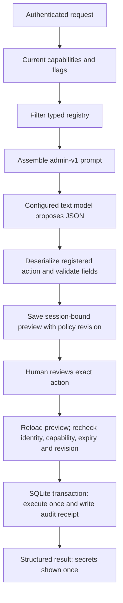

# Conversational administration and the internal tool registry

The existing [Ordo repository](https://github.com/kaw393939/ordo) describes the Agentic Business Appliance: interchangeable models surrounded by identity, policy, deterministic commands, artifacts, review, audit and recovery. Its preferred production runtime is Elixir/Phoenix and its README says that runtime has not started. This repository is a Rust/Svelte teaching implementation of a bounded operational slice; it does not silently replace that product roadmap.

We reviewed its [architecture blueprint](https://github.com/kaw393939/ordo/blob/main/development-docs/SYSTEM-ARCHITECTURE.md), [capability policy](https://github.com/kaw393939/ordo/blob/main/agentic-appliance/runtime-spec/capability-policy-v0.md), [gateway and registry specification](https://github.com/kaw393939/ordo/blob/main/agentic-appliance/runtime-spec/llm-gateway-tool-registry-v0.md), and [prompt assembly runtime](https://github.com/kaw393939/ordo/blob/main/agentic-appliance/architecture/prompt-assembly-runtime.md). Those are design references, not claims that the entire business appliance exists here. This code independently implements the concepts in this repository's Rust stack.

## The complete administrative loop

Open your account's settings and choose **Administration**. For example, type “Invite a student with username alex373.” The planner proposes one `users.invite` action. The interface shows the exact target and fields. Confirming produces the private invitation link and a receipt. Share the link yourself through a private channel. The model neither emails it nor receives it in a follow-up prompt.



The chat assistant and administration workspace are separate. Normal chat processes documents as evidence and has no administrative execution channel. The admin planner receives the current request, up to six bounded prior requests/questions/previews (at most 6 KiB), and authorized tool metadata. Follow-up answers can therefore resolve a clarifying question. This client-supplied history is untrusted context, never evidence of execution or authority. Attachments, retrieved documents, invitation tokens, API keys, passwords and other people's conversations are absent from that prompt. The planner can ask for missing information; it cannot call a shell, invent an API endpoint or grant itself capabilities.

## The registry is code, not a list in a prompt

`src/control.rs` is the single registry and policy module. Each tool has a name, version, description, JSON input schema, required capability, scope, privacy classification, side-effect declaration, timeout metadata, retry policy, review requirement and idempotency policy. Rust's tagged `Action` enum defines accepted commands. `deny_unknown_fields` rejects extra properties such as `admin: true` added to an invitation. The dispatcher matches that enum; there is no dynamic function lookup or arbitrary command execution.

| Tool | Required capability | Effect |
| --- | --- | --- |
| `users.list` | `user:read` | Account names, roles, active/enrolled states |
| `users.invite` | `user:invite` | Reserve a member and issue a 24-hour link |
| `users.set_active` | `user:manage` | Enable/disable a member; revoke sessions |
| `flags.list` | `policy:manage` | Read current feature availability |
| `flags.set` | `policy:manage` | Change one named feature flag |
| `capabilities.set` | `policy:manage` | Set an allowed member capability override |
| `usage.read` | `usage:read` | Aggregate request/account counts and limits |
| `audit.read` | `audit:read` | Last 50 administrative audit events |

The tools operate on local SQLite state. None calls arbitrary external endpoints. Registry timeout metadata is an execution budget for these bounded local commands; database lock waits are capped at five seconds. The planner has a 60-second timeout and an 8 KiB response limit. There is no automatic repair/retry loop. A failed plan can be rephrased or bypassed using **Choose an action directly**, which still uses the same preview and authorization path.

A typed proposal looks like this:

```json
{
  "tool": "flags.set",
  "arguments": { "name": "research", "enabled": false }
}
```

`POST /api/control/propose` accepts either `{ "request": "..." }` or `{ "action": { ... } }`, never both. The direct action route is useful for deterministic UI controls and tests. `GET /api/control/catalog` returns only tools the current account may use. `POST /api/control/execute` accepts only a saved preview ID; the client cannot swap its arguments at confirmation time.

## Dynamic prompts are assembled from authoritative context

There are two small prompt assemblies:

1. Normal chat combines the grounded/general system policy with a runtime capability/feature summary. Retrieval evidence, bounded history and current input are assembled separately. Chat still cannot execute tools.
2. Administration combines a fixed `admin-v1` policy, the filtered registry and a strict JSON output contract. The current request and bounded conversation history are separate messages. No account list or tool result is silently sent to the model.

This is the first implementation of Ordo's named-slot idea, not a complete prompt-packet platform. Version and authorized action metadata are retained with the preview/receipt; full prompt bodies and chain-of-thought are not logged. Future prompt packets can add source manifests, exact token counts, privacy preflight and approved business-profile snapshots without changing the execution authority.

The adapter boundary remains provider-neutral: the planner calls `Generator::generate`, then validates JSON independently of Groq or Ollama. Native provider tool-calling is not required. A new provider may improve structured output reliability, but its proposed JSON must still pass the exact same registry, policy and transaction checks.

## Preview, confirmation and idempotency

A preview stores its actor ID, session digest, canonical action, current policy revision, ten-minute expiry and executed state. It is private to that actor and session. Account or policy mutations increment the global revision. A preview based on earlier state becomes stale and must be recreated; this conservative approach is easy to inspect for a small instance.

Execution takes a SQLite immediate transaction, reloads the preview, verifies the active session and current capability, rejects stale/expired state, performs the typed mutation, marks the preview consumed and records the audit event in one commit. Repeating a completed preview returns “already completed”; it does not create another account or another invitation. One-time invitation results are not retained for replay. If the network drops after a successful invitation, use the operator reset command to replace that invitation; do not assume a missing UI response means the transaction rolled back.

Read queries also require an explicit **Run query** action and receive an audit receipt. Rejected authenticated control requests record an HTTP status without logging the request body. Audit rows are append-only through application APIs; the host/database owner could alter them, so this is not a cryptographically tamper-evident ledger.

## Feature flags and capabilities solve different problems

A feature flag pauses a feature for the instance. A capability grants an account authority to use an action. The effective decision requires both when applicable.

| Flag | Enforcement |
| --- | --- |
| `chat` | Prevents new normal chat/model runs |
| `research` | Prevents semantic/keyword research runs and search requests |
| `multimedia` | Prevents new uploads and attaching files to new runs |
| `admin_assistant` | Prevents model-assisted planning; direct reviewed admin actions remain available |

Flags are persisted in `auth.sqlite`, survive restarts, default to enabled, and can be changed only through a reviewed policy command. They do not erase existing conversations/files, revoke all sessions or cancel already-admitted work. Disabling a user does revoke sessions and terminates their active work. There are no rollout percentages, remote flag service, billing entitlements or tenant-specific flags yet.

## What makes this a small hosted MVP

Implemented: private accounts, invitations and recovery, streaming chat, independently configured model roles, multimedia extraction, semantic retrieval, capability checks, reviewed conversational administration, flags, request/storage bounds, audit receipts, pinned container releases, HTTPS, and scoped deployment/backup tools.

Deliberately separate next increments:

| Next outcome | Why / acceptance criterion |
| --- | --- |
| Account retention and deletion | A user can export and erase their data under an explicit retention policy; backup expiry is explained |
| MFA/SSO and account recovery | Stronger owner access and institution-managed identity, with tested recovery |
| Usage and spend ledger | Persist actual provider token/audio usage; distinguish estimates, costs and customer charges |
| Billing | Payment provider integration, entitlements and webhook idempotency; no invented charges from model prose |
| Durable jobs and stream replay | Long ingestion survives disconnects/restarts and has cancel/retry semantics |
| Work matters and reviewable artifacts | A conversation creates a versioned briefing/proposal with deterministic pricing and human review |
| Organizations and sharing | Explicit ownership/scope migrations and cross-tenant negative tests before shared access |
| Governed external tools | Credential isolation, output validation, allowlisted destinations and reviewed side effects |
| Monitoring and service objectives | Measured load, alerts, error budgets and recovery drills before promising uptime |

These align with the upstream Ordo roadmap without pretending that a polished chat UI implements payments, proposals, a workflow DAG, MCP, an encrypted privacy vault or high availability.

## Extend it as a class exercise

Add a read-only `workspace.describe` tool that returns only public workspace metadata. Define its capability and typed arguments, registry metadata, deterministic handler and result contract. Test that an unauthorized account cannot see it in the catalog, cannot obtain it in the planner prompt and cannot invoke it directly. Test invalid/extra arguments and a stale preview. Then add one state-changing tool and prove a repeated confirmation cannot execute it twice. Do not begin with a generic shell tool.
