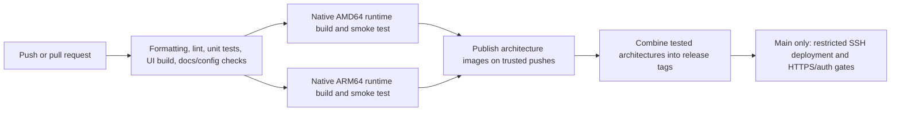

# Containers and CI/CD

A Docker **image** is a packaged filesystem and startup configuration. A **container** is a running instance of that image. A **volume** persists data independently of a container. A **registry** stores images so another machine can pull the same build. None of these is a model: model weights remain separate runtime assets.

The [Dockerfile](../../Dockerfile) builds the Svelte UI with Node, compiles Rust, builds a pinned whisper.cpp revision, and copies the results into a Debian runtime containing FFmpeg and Poppler. Build compilers do not remain in the final stage. The runtime uses UID 10001. Node is not needed to serve the built frontend; Axum serves it. Dependency lockfiles and pinned toolchain/action versions reduce variation, but base distribution tags and package repositories can change. An image digest identifies the exact published artifact.

## Run an image

Use the [setup assistant](setup.md) first to install models and import the corpus. It selects host Ollama or the optional Compose service and creates `.env.local`.

```sh
docker compose --env-file .env.local pull app
docker compose --env-file .env.local up -d
docker compose --env-file .env.local ps
docker compose --env-file .env.local logs --tail=100 app
```

Open http://127.0.0.1:3730. The [Compose file](../../compose.yaml) publishes the app only on loopback. `app-data` holds SQLite and Whisper weights; `ollama-data` holds weights for the optional Ollama container. `docker compose down` preserves named volumes. Adding `--volumes` destroys that stored data; do not use it as routine troubleshooting.

The image is [kaw393939/is373-rust-rag on Docker Hub](https://hub.docker.com/r/kaw393939/is373-rust-rag). `latest` follows successful main-branch publication; `sha-<full-commit>` ties a build to source; `v...` tags identify requested releases. Inspect the manifest, then set `ORDO_IMAGE` in `.env.local` to `kaw393939/is373-rust-rag@sha256:<verified-digest>` for reproducibility:

```sh
docker buildx imagetools inspect kaw393939/is373-rust-rag:latest
```

The manifest combines Linux AMD64 and ARM64 images. Docker selects the native architecture. Model weights and keys are absent from both architectures.

## Follow the pipeline



Read [ci.yml](../../.github/workflows/ci.yml). Pull requests run checks and image smoke tests without publishing. Trusted pushes to `main`, version tags and manual runs also publish. Both native image jobs must pass before the shared manifest is updated. Each image includes source/revision labels, provenance and an SBOM (a software component inventory). These improve traceability; they are not a security certification.

`scripts/check_container.py` starts its own disposable container, checks non-root execution and native tools, then exercises real PDF extraction, video sampling, stored JPEG access and browser Origin handling with a mapped port. It deliberately has no model/key: the expected generation outcome is unavailable. Real inference is evaluated separately. The separate embedding smoke test downloads about 67 MB of pinned weights and tests real normalized vectors under the production memory cap. CI does not download generation weights or consume an instructor's hosted key.

## Publish from your fork

Create your own Docker Hub repository. In GitHub repository Settings → Secrets and variables → Actions, configure variable `DOCKERHUB_USERNAME` and secret `DOCKERHUB_TOKEN`. The token needs repository read/write access; do not grant delete or unrelated cloud permissions. A Docker personal token can cover other repositories the account accesses, so treat it as an account credential and rotate it before expiry. Use a dedicated publisher identity or suitably scoped organization credentials when available.

The image name in this workflow is `<username>/is373-rust-rag`; update it if your repository uses a different name. GitHub does not copy secrets to a fork. Never place the token in YAML, build arguments, issues or logs. See [Docker token documentation](https://docs.docker.com/security/access-tokens/personal-access-tokens/) for current account controls.

To release, start from a reviewed commit whose checks pass, tag it with a new version such as `v0.1.0`, and push that tag. Watch every job in Actions and inspect the registry digest before declaring publication successful. A running workflow is not a completed release. Successful main-branch publication also deploys the two tested image digests through a restricted SSH command; version tags publish without deploying. See the [production runbook](production.md) for required secrets, immutable releases and gates.

## Deployment, backup and rollback

Keep a previous image digest and a consistent database backup before upgrades. Stop the app before copying the SQLite database and any WAL/SHM state, or use SQLite's online backup API. Back up keys separately under access controls; model weights can be redownloaded from recorded versions/checksums. Test a restore in a separate volume before relying on the backup. Do not replace a newer database with an older binary without checking schema compatibility.

Rollback means selecting the earlier digest, pulling it and recreating the app container against a compatible volume. Model configuration and data are separate from the image, so changing an image alone does not necessarily roll back a model or imported corpus.

The default local profile can also be reached through a private SSH tunnel. The separate authenticated production profile provides identity, private account storage, HTTPS integration, quotas, reviewed admin commands and scoped backup/release operators. Follow the [production runbook](production.md), including its remaining retention, monitoring and recovery limitations. Do not publish port 3730 directly or disable Host/Origin checks.
