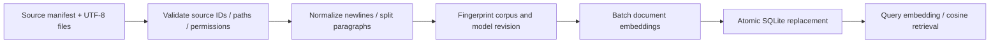
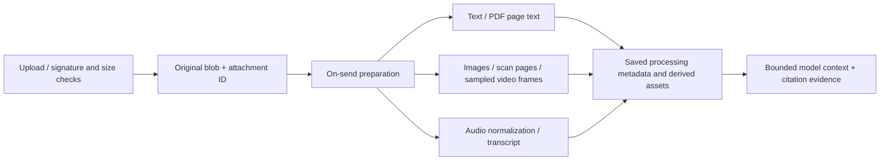

# ETL, ingestion and data lineage

ETL means extract, transform and load. This repository has two real ingestion paths. Keep them distinct when explaining the application: the knowledge library builds a reusable retrieval index; attachments prepare material for a conversation.

## Path A: the indexed knowledge library

Run `cargo run --locked -- import` from the repository root. An alternate corpus directory can be passed after `import`. The importer expects `manifest.json` plus UTF-8 text files; it is not a general web crawler or PDF/video library importer.

Each manifest entry has `id`, `title`, `file`, `origin`, `permission` and `version`. Paths must remain inside the corpus directory. IDs must be unique and use letters, numbers, underscores or hyphens. Origin URLs must use HTTP(S), and permission/version fields must be nonempty. These fields make provenance inspectable; filling them in is not proof that you have permission.

The transform stage normalizes CRLF newlines and splits text at blank lines. Empty paragraphs and a paragraph starting with `# ` are skipped. Paragraphs above 4,000 bytes are rejected. IDs use the original paragraph position, so the heading can cause the first content chunk to be `p2`. Positions are stable for unchanged source structure, not forever stable under arbitrary edits.

The importer fingerprints the raw manifest and source contents, then checks the embedding provider/model/revision. An unchanged import does no embedding work. A change rebuilds the small collection. This prevents repeat-import duplicates; it does **not** detect all semantically duplicate documents or merge identical text under different source IDs.

Embeddings are created in batches of 16. The model identity is checked again after embedding to avoid mixing revisions when a mutable model tag changes during import. Only after all embeddings succeed does a SQLite transaction replace `sources`, `chunks`, `vectors` and index metadata. Failed embedding work leaves the previous index usable. The current bound is 1–100 sources and 1–1,000 chunks; this is intentionally a small teaching corpus.

## Path B: conversation attachments

Uploading stores a file; expensive processing begins when the user sends a message. Text files become reference text. Images are decoded, bounded and normalized. Poppler extracts PDF pages, rendering pages without a useful text layer. FFmpeg samples a video's frames and extracts its first audio track. Whisper produces text from audio. Each stage reports errors explicitly.

Processed text and derived image blobs are saved locally. Cache keys include pipeline configuration, and video adds the speech model/language key. A follow-up uses the original message snapshot, rather than silently changing earlier evidence after a model update. Binary changes at the same configured path are not automatically fingerprinted; re-upload to force fresh extraction after a native-tool upgrade.

PDF evidence uses page IDs; videos use frame IDs and a separate audio transcript ID. The model receives actual images with labels linking them to those IDs. The UI lets users inspect page text, frame thumbnails and transcripts. These references are conversation evidence; uploads are not automatically embedded into the shared library.

## Storage map

| Table / asset | Purpose |
| --- | --- |
| `metadata` | Index identity, dimensions, fingerprint and import timestamp |
| `sources` | Manifest entries |
| `chunks` and `vectors` | Paragraph evidence and vector representation |
| `conversations` | Saved messages, outcomes, evidence and attachment snapshots |
| `attachments` | Original file blobs and processing metadata |
| `media_assets` | Generated page/frame JPEGs, associated with parent attachments |
| Downloaded model files | Inference weights on disk; excluded from Git and images |

The native database defaults to `data/rag.sqlite`. Docker keeps it in the `app-data` volume. SQLite WAL sidecars are part of live database operation; use a proper SQLite backup or stop the service before copying the complete database state. Removing a container does not remove its named volumes. `docker compose down -v` deletes volumes and is not a routine restart command.

## What a fuller ETL system would add

A background pipeline could persist jobs with queued/running/succeeded/failed states, retry policy, stage versions, source hashes, audit events and a reviewed promotion step into the library. It would need cancellation, bounded resource use, per-user permissions and an explicit retention policy. A watched folder or scheduled connector also needs deletion/update semantics and a way to avoid importing private or unapproved content.

Those are extensions, not hidden capabilities of this app. Start by designing a job record and testing one idempotent PDF-to-library import. Preserve page locations and extraction version. Do not simply rename the current on-send attachment handler as a durable ETL service.
