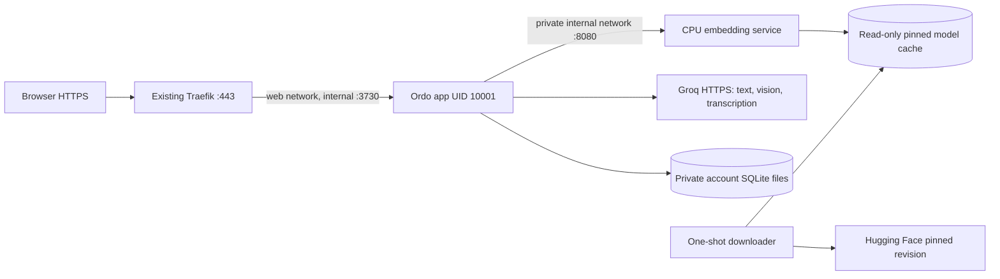

# Deploy Ordo to a small production host

This chapter explains the instructor deployment and a reproducible process for your own host. It is not permission to access the instructor's server or reuse their credentials. The public URL is [ordo.keithwilliams.org](https://ordo.keithwilliams.org); accounts are invitation-only. The [authentication chapter](authentication.md) and [control-plane chapter](control-plane.md) explain the application boundary.

## Deployment inventory and requirements

The instructor's project inventory identified an existing DigitalOcean Ubuntu 24.04 host in NYC1 with one vCPU, 2 GiB RAM and a 50 GiB disk. It already runs other class services and a Traefik reverse proxy. The GoDaddy `ordo` A record resolves to that host; no DNS change is necessary. The apex site and other hostnames remain separate.

| Component | Production choice | Reason |
| --- | --- | --- |
| Web app | Rust/Axum with built Svelte assets | One non-root app container; no Node server |
| TLS/ingress | Existing Traefik, Let's Encrypt, Docker network `web` | Reuse ports 80/443 and existing certificate automation |
| Text and admin planning | Groq `openai/gpt-oss-20b` | Avoid a local generation model on a shared 2 GiB host |
| Vision | Groq `qwen/qwen3.8-27b` | Understand images, scanned pages and sampled frames |
| Transcription | Groq `whisper-large-v3-turbo` | Normalized audio is sent to speech recognition |
| Embeddings | Local FastEmbed 0.9.1, BGE-small-en-v1.5 | 384-dimensional CPU embeddings; no cloud embedding key |
| Extraction | Local Poppler and FFmpeg | Preserve page/frame/transcript provenance |
| Persistence | SQLite WAL in `ordo_app-data` | One app process, bounded class-sized data |
| Model files | `ordo_model-cache` | Download once; pinned revision and SHA-256 files |
| Secret | Read-only file mounted to UID 10001 | Key absent from images, browser and repository |

An independently hosted copy needs a domain, a Linux server with Docker Engine and Compose v2, an HTTPS reverse proxy, an SSH administrator with a verified host key, a Groq project/key with access to all configured models, and a backup encryption recipient whose private identity you can recover. Allow outbound HTTPS for registry pulls, the one-time model download and Groq requests. Open the web proxy's 80/443 and restrict SSH to your administration policy. Do not open 3730 or 8080 publicly.

The production Compose profile caps the app at 384 MiB and embeddings at 320 MiB, with CPU/PID limits. The real embedding container measured about 152 MiB in the local constrained smoke test; memory use under a different workload can vary. Leave capacity for the OS, proxy and other applications. For a fresh dedicated student host, 2 GiB is a starting point for hosted inference, not a concurrency guarantee. A 4 GiB host gives more operational room. Fully local generation/vision requires the substantially larger hardware in [setup](setup.md).

Groq currently charges each Qwen image as 2,048 input tokens and supports up to three images per request. The instructor account's input-token allowance was 7,000/minute during verification. The hosted profile uses **two** video frames and `VISION_MAX_IMAGES=2` so the frames leave room for instructions and transcript text. The local profile keeps its three-frame default. These are sampled still images, not continuous video understanding. See [Groq vision](https://console.groq.com/docs/vision) and [rate limits](https://console.groq.com/docs/rate-limits); account limits can change independently of the model context window.

## Understand the networks and files



Only the app joins `web`; the embedding service joins an internal network without internet egress. The one-shot download service has a separate outbound network and is removed after it completes. Neither app nor embeddings mounts the Docker socket. Both run without Linux capabilities, with no-new-privileges, a read-only root filesystem, bounded temporary storage and bounded logs.

On the host:

```text
/opt/ordo/
  compose.yaml             root-managed production topology
  domain                   configured public hostname
  .env                     immutable image digests + hostname; no API key
  .env.previous            previous image configuration
  release.json             last successful release identity
  secrets/groq-api-key     owner 10001:10001, mode 0400
  docker-public/config.json
/usr/local/sbin/ordo-release         root-owned release validator
/usr/local/sbin/ordo-deploy-trigger  fixed SSH entry point
/usr/local/sbin/ordo-backup          backup entry point
/var/backups/ordo/*.tar.gz.age        encrypted snapshots, last seven retained
```

The Groq file's parent directory is root-only; Docker mounts just the file, which the application UID can read. Keep your administrator private key on your client. The CI deploy key is a separate key with a forced command and SSH restrictions; it is not the general administrator key.

## Initial provisioning on your own host

1. Confirm the host inventory, free memory/disk, existing proxy routes and Docker networks. Record the SSH host fingerprint through a separate trusted channel. Do not accept an unexpected host-key change automatically.
2. Add your domain's A/AAAA records as appropriate for your host. Verify resolution and ports 80/443. Configure Traefik's Docker provider with `exposedByDefault=false`, the `web` network, HTTP→HTTPS redirection and a Let's Encrypt resolver named `letsencrypt`. If you use another proxy, adapt the labels and test the preserved Host and SSE behavior.
3. Create `/opt/ordo` and a private secrets directory. Install [compose.production.yaml](../../deploy/compose.production.yaml) as `/opt/ordo/compose.yaml`. Write your hostname to `/opt/ordo/domain`. Copy [production.env.example](../../deploy/production.env.example) to `.env` and replace both placeholders with tested image digests. These are different images in the same registry repository.
4. Install your own Groq key through a private file transfer or secret manager. Set the mounted file's ownership to `10001:10001` and mode to `0400`. Do not put it in a shell argument, Docker build argument, screenshot, Git commit or issue. A credentials file is not automatically provided by cloning this repository.
5. Set up an `age` recipient list at `/etc/ai-server-infra/recipients.txt`, or adapt that path in the operator for your server. Keep the decrypting identity independently recoverable. Encrypting a backup is easy; recovery requires the private identity.
6. Review and install the root-owned [release operator](../../deploy/ordo-release.py) and [forced-command wrapper](../../deploy/ordo-deploy-trigger). The script deliberately fixes the registry repository and project paths. Forks must review and change those constants and the expected source label. It is not a general host administration endpoint.
7. Install the dedicated deploy public key in the intended user's `authorized_keys` with `restrict,command="/usr/local/sbin/ordo-deploy-trigger"`. Grant only the no-argument `/usr/local/sbin/ordo-release` command through sudoers, and validate it with `visudo`. Do not copy an unrestricted SSH key or grant blanket passwordless sudo.
8. Install the backup service/timer from `deploy/`, reload systemd, and enable the timer after the first successful deployment. The instructor schedule is 04:40 America/New_York, offset from the host's existing backup schedule.

No students should copy the instructor's IP, secret key, Keychain entries or SSH credentials into their project. Use the same principles with infrastructure you are authorized to administer.

## From tested commit to running service

The workflow [ci.yml](../../.github/workflows/ci.yml) has four stages:

1. Rust formatting, Clippy, unit tests, credential-free account/control-plane integration tests, frontend tests/build and docs/config checks.
2. Native AMD64 and ARM64 application builds with extraction smoke tests; embedding builds with a real pinned-model download, normalized-vector check and 320 MiB memory cap. The actual production Compose profile also boots in an isolated test project, imports the corpus and exercises secure-cookie authentication with synthetic credentials.
3. Publish tested architecture images, provenance/SBOM metadata and combined manifests. App tag: `sha-<commit>`. Embedding tag: `embeddings-sha-<commit>`.
4. For `main` only, send the two immutable manifest digests and source revision through restricted SSH. Pull requests never publish or deploy; version tags publish without automatically replacing production.

Configure these GitHub Actions settings on your own repository:

| Setting | Kind | Purpose |
| --- | --- | --- |
| `DOCKERHUB_USERNAME` | variable | Registry namespace |
| `DOCKERHUB_TOKEN` | secret | Repository publishing credential |
| `ORDO_DEPLOY_HOST` | variable | Authorized deployment host |
| `ORDO_SSH_KNOWN_HOSTS` | variable | Independently verified public SSH host key entry |
| `ORDO_DEPLOY_SSH_KEY` | secret | Dedicated forced-command private key |
| `production` | environment | Deployment history and optional organization-controlled approval policy |

The release request is only JSON, for example:

```json
{
  "revision": "40-character-source-commit",
  "app_digest": "sha256:64-character-app-manifest-digest",
  "embedding_digest": "sha256:64-character-embedding-manifest-digest"
}
```

The operator rejects malformed input, arbitrary registry names and image/source labels inconsistent with the revision. It serializes deployments/backups with a lock, snapshots existing data, downloads/verifies model files, starts embeddings, imports the shared corpus with the new embedding identity, then starts the app. It waits for container health, valid public TLS and an unauthenticated `/api/conversations` response of **401**. Only then does it record the successful release. Images are selected by digest; mutable `latest` is not a production input.

The registry/source labels are a consistency check, not a signature or independent supply-chain attestation verification. Protect repository write access, the Actions environment and publisher/deploy secrets. The current root-managed Compose and operator files are installed by an administrator; CI can select tested images but cannot replace its own privileged deployment script. Changes to those host files require an explicit operator rollout.

## Bootstrap and use the owner account

After the first healthy deployment, an authorized operator runs `is373-rag auth invite <username> --admin` inside the app container and saves the emitted link privately. The owner opens it and chooses their own password. No shared default password is built into the image. A link expires after 24 hours; `auth reset <username>` produces a replacement and revokes previous sessions.

Once signed in, open settings → Administration. Ask to invite students, inspect usage, pause a feature, or inspect the audit. Every mutation has a preview and confirmation. Never paste production secrets into the administrative conversation. The assistant has no secret-reading tool and no general server shell.

## Verify the deployment

Record the source SHA, both image digests, workflow URL, UTC timestamp and results. A healthy process does not establish correct authentication or model behavior.

```sh
curl --fail https://your-domain.example/api/health
curl -s -o /dev/null -w '%{http_code}\n' https://your-domain.example/api/conversations
# Expected: 401, never conversation JSON.
sudo docker compose --project-directory /opt/ordo ps
sudo docker stats --no-stream
sudo systemctl list-timers ordo-backup.timer
```

Use synthetic accounts to test enrollment, logout, a rejected foreign Origin, two-account isolation, a live streamed grounded answer, a scanned PDF and narrated video, admin preview/execution and secret-free audit. [check_hosted.py](../../scripts/check_hosted.py) performs the live model portion using a private test-account JSON file and generated synthetic fixtures. It makes real provider calls; do not include that credentials file in the repository. It deliberately spaces vision requests for the free account allowance. Record model quality separately from transport success.

Also verify the existing host's other containers remain healthy. App health does not establish that neighbors stayed healthy under load. One admitted inference at a time and the free provider allowance make this an invitation-only class MVP; measure before increasing concurrency or class-wide demand.

## Backup, restore and rollback

The Ordo backup timer is separate from the host's pre-existing full-backup system. Do not assume an old script automatically discovers a newly deployed project. `/usr/local/sbin/ordo-backup` obtains the deployment lock, stops only Ordo's app, copies its volume and configuration, checks SQLite integrity and restarts the app. It encrypts the archive with `age` and retains the seven most recent completed snapshots. Model files are excluded because the pinned lock file can reproduce them. Backups contain credentials and private account data, so plaintext staging is root-only and removed afterward; encrypted files remain root-only too.

There is a short maintenance interruption during the consistent copy. Daily same-host backups protect against mistakes but not loss of the entire droplet. Copy encrypted snapshots to an independently controlled location and test your own retention policy before promising disaster recovery. The CI operator also snapshots before replacing an existing release.

Restore drill, using an authorized recovery machine with the `age` private identity:

```sh
umask 077
mkdir -p restore-drill
age --decrypt -i /private/path/backup-identity.txt /private/path/snapshot.tar.gz.age \
  | tar xzf - -C restore-drill
# Run PRAGMA quick_check on every restored *.sqlite and verify expected account/data counts.
# Use a NEW isolated volume and a loopback test origin; never mount this over production.
```

Validate the image/config version, invitation/session policy, corpus identity, original files, derived assets and account separation in the isolated restore. Disable or replace provider credentials during a drill unless real calls are specifically intended. After a real recovery, revoke restored sessions and reset any exposed credentials: a backup may contain older sessions that were revoked after its creation. Add a recovery runbook entry with measured recovery time and data loss window.

For an image rollback, select the recorded previous **app and embedding** digests and recreate the Ordo services with the same reviewed Compose file. The deployment operator restores the prior image configuration if a new health gate fails. It does not automatically reverse database migrations or restore an older corpus snapshot; inspect compatibility and restore from backup if necessary. Future incompatible migrations must include an explicit recovery plan. Never `docker system prune`, remove shared networks, change other Compose projects, or run `down --volumes` as a deployment shortcut.

## Rotation and troubleshooting

The instructor Groq key expires December 13, 2026; the publishing token expires December 14, 2026 in the account's local timezone. Operators must replace expiring credentials before then. Rotate a provider key by privately installing its replacement file with the same ownership/mode, recreating the app so it rereads the key, verifying live inference, then revoking the old key. Rotate the publishing token in its GitHub secret and verify the next publish. Rotate the dedicated deployment key by testing a new restricted public key before removing the old one.

401 means sign-in is required or expired. 403 can mean wrong Host/Origin, missing capability, paused feature or disabled account. 409 on a command preview means stale/expired policy state; create a new preview. 429 can come from Ordo's request limits or the model provider. A Groq input too large error can reflect the account's per-request token allowance even when the model itself supports a larger context. Reduce images/context or configure a suitable provider plan; do not silently send data to another vendor. A 503 during import may indicate an unavailable embedding service or changed model identity. Inspect redacted service logs and rerun import only after the model is healthy.
